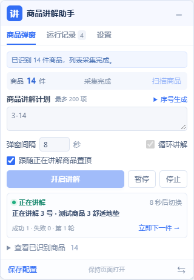

# 百度直播商品自动讲解助手



用于百度直播主播工作台的 Chrome / Microsoft Edge 扩展。按照商品序号计划，定时点击“讲解商品”，等待按钮变为“取消讲解”后再记为成功。默认间隔 **8 秒**，每轮计划最多 **200 项**，支持 `1-200` 循环讲解、暂停、继续和停止。

扩展沿用网页当前的登录状态，通过页面上的商品按钮操作；无需百度 SDK、接口密钥、录音或视频识别。适用地址：<https://cecom.baidu.com/liveB/login#/home>。

## 安装

交付物位于 `release/`：

- `baidu-live-assistant/`：可以直接加载的扩展目录，内部含 `manifest.json`。
- `baidu-live-assistant-v1.0.5.zip`：同一扩展的压缩包，清单文件位于 ZIP 根目录。**先解压，再选择含 `manifest.json` 的目录**，例如 `baidu-live-assistant-v1.0.5/`。浏览器的开发者加载功能不能直接加载 ZIP。

Chrome：地址栏打开 `chrome://extensions/`，开启右上角“开发者模式”，点击“加载已解压的扩展程序”（部分版本为“加载未打包的扩展程序”），选择上述扩展目录。

Edge：地址栏打开 `edge://extensions/`，开启“开发人员模式”，点击“加载解压缩的扩展”，选择同一个扩展目录。

开发时也可以直接加载源码目录 `extension/`。更新文件后在扩展管理页点击“重新加载”，再刷新百度工作台页面。

### 从旧版本更新

1. 如果已加载本工程的 `release/baidu-live-assistant/`，该目录已更新，直接在扩展管理页点击本扩展的“重新加载”。
2. 如果加载的是另行解压的目录，把 1.0.5 ZIP 解压后的文件覆盖到原目录，再点击“重新加载”。扩展详情中的版本应为 **1.0.5**。
3. 刷新百度直播工作台并重新扫描商品。完整识别到 1–200 号后，将计划填写为 `1-200`，勾选“循环讲解”并开始，执行第 200 件后会回到第 1 件。

1.0.5 将跟随改为商品列表内置顶：正在讲解的商品即使已经可见，也会滑到列表允许的最上方；末尾商品到达滚动极限时停在能达到的最高位置，外层工作台不滚动。折叠浮条实时显示已确认商品序号，暂停和停止时保留最近确认的序号。主面板缩短为紧凑布局，序号生成器默认折叠，常用运行按钮、间隔、循环和跟随开关直接可见。

1.0.4 增加“跟随正在讲解商品”开关，位于间隔设置下方。默认开启，可在运行中切换，立即保存，刷新后恢复。开启时只在直播商品列表内部跟随，下一次切换商品生效；关闭时在讲解确认后保持原浏览位置。虚拟列表为定位离屏商品可能短暂滚动，完成后自动回到原位置。扫描商品仍会按需滚动读取完整列表。

1.0.3 将每轮计划上限设为 200 项，序号生成器默认范围为 `1-200`，新配置默认开启循环。空计划扫描后按真实商品生成，最多选取前 200 件；商品不足 200 件时不补造缺失商品。有效的已保存计划继续保留；超过 200 项的旧计划会清空，间隔、循环偏好和高级选择器保留。

1.0.2 修复跟随讲解带动整个工作台滚动的问题。切换商品、末件回到首件及扫描时，只调整商品列表内部的滚动位置；没有独立商品滚动容器时，不滚动整个页面。已经在讲解的商品也可在列表内跟随显示，不重复点击“取消讲解”。

1.0.1 已修复真实百度工作台中的序号、身份和标题识别，并支持标题栏与折叠条拖动、位置记忆和屏幕边界限制。

## 使用

1. 登录百度直播工作台，进入对应直播间，打开“直播商品”列表。不要停留在登录页面或“闪电购商品”页。
2. 页面会显示“商品自动讲解”面板。也可以点击浏览器工具栏中的扩展图标显示或隐藏面板。
3. 点击“扫描商品”。检查识别数量、序号和商品名称；分页或虚拟滚动列表的扫描可能需要等待。扩展会在商品列表内部滚动或翻页读取商品。
4. 填写计划，例如 `1-200`、`1,3,5-8`，或展开“序号生成”填写起止序号。计划中的数字是后台显示的商品序号，不是商品 ID。每轮最多 200 项，勾选“循环讲解”后按计划重复执行。
5. 设置弹窗间隔，默认 `8` 秒；按需开启循环。点击“开始”后执行第一个商品，再按间隔切换下一件。
6. “暂停”会停止推进；“继续”接着当前计划；“停止”结束本次任务。停止和暂停不会取消当前已经讲解的商品。刷新页面、重新登录或重新打开浏览器后，需要手动重新扫描和开始。
7. 按住面板顶部标题栏拖动；折叠后也可拖动小浮条，浮条显示当前已确认的商品序号。松开后保存位置，底部“⇆”按钮可恢复左右吸附。
8. 按需勾选或取消商品跟随开关，无需停止计划或额外点击保存；开启时商品在列表内部滑到允许的最上方，工作台外层位置保持不变。

截图示例显示 72 件商品，应生成 `1-72`；实际若只有 71 件，使用 `1-71` 或扫描得到的真实序号，不应添加不存在的第 72 件。对已发到网站的点击，暂停/停止无法撤回请求，但会阻止后续点击。

计划、间隔及设置可以保存在本机，也可导出 JSON 备份后导入。每轮最多讲解 200 项，重复序号也计入计划项数。扫描仍可完整读取较大的商品列表（默认最多 10000 件），自动计划只选取按序号排列的前 200 件。实际可用数量取决于工作台能展示和读取的商品；显式计划 `1-200` 必须对应已识别的完整 1–200 号商品，缺号时会提示修改计划或重新扫描。

## 页面适配与故障处理

- **没有面板**：确认当前网站是 `cecom.baidu.com`，刷新页面，点击扩展图标；检查扩展管理页是否已启用扩展。
- **清单文件丢失或不可读取**：选择的文件夹层级不对。打开该文件夹，确认其中直接包含 `manifest.json`；不要选择 ZIP 文件或上一级 `release/`。最新版压缩包已去掉多余的内层文件夹。
- **识别不到商品**：确认已经登录并打开直播商品页。等待商品加载完成后重新扫描。
- **编号或按钮识别错误**：在“设置”中填写页面元素的 CSS 选择器，例如商品行、行内序号、名称、讲解按钮、下一页和滚动容器。选择器只影响页面识别；不会调用未公开的百度接口。
- **点击后没有变成“取消讲解”**：检查直播间是否可操作、网络和工作台提示。扩展会将确认超时记录为失败，不会直接当作成功。连续失败会自动暂停，检查后再继续。
- **页面切换、商品重新排序或增删**：先停止，重新扫描并核对计划，再开始。扩展会在执行时重新核对商品身份，避免沿用过期的行位置。
- **窗口关闭、电脑休眠或页面被浏览器冻结**：定时任务不能继续，唤醒后检查状态并手动恢复。浏览器后台节流也可能使实际间隔延长。

“运行记录”和诊断导出用于查看扫描结果、错误与选择器。导出的诊断内容不包含账号密码或登录 Cookie。

## 本地开发与验证

需要 Node.js 20 或更新版本。

```powershell
npm install
npx playwright install chromium
npm test
npm run check
npm run build
```

测试使用 `tests/fixtures/live-console.html` 构造的本地商品工作台，覆盖商品扫描、讲解状态确认及计划调度；不连接真实直播间。可用查询参数切换模拟数据：`?count=200&mode=paged&pageSize=20` 或 `?count=200&mode=virtual`。

`tests/fixtures/baidu-console.html` 保留用户保存页面的商品卡片、序号输入框、data-key 身份、虚拟滚动与 div 按钮结构，使用虚构商品数据。添加 `?layout=nested` 可测试页面、工作台、商品列表三层滚动场景。`node scripts/check-saved-page.cjs <保存的HTML文件>` 可对本地页面做离线只读识别比较；不会执行原页面脚本或请求网络。

`npm run verify:extension` 使用独立临时浏览器配置验证实际扩展加载，并将目标域名请求替换为本地模拟页面。Windows 上默认检测已安装的 Chrome / Edge，不访问已有浏览器账号。测试输出在 `test-results/`。

真实百度工作台需要登录，本次交付不包含账号，也不声称已完成真实直播间点击验收。请按 `docs/验收清单.md` 在有权限的测试直播间确认页面适配后使用。

## 权限与文件

扩展只在 `https://cecom.baidu.com/*` 运行；本地存储用于保存计划和面板设置。源代码位于 `extension/`，发布包由源码生成，不依赖远程脚本或第三方服务。

参考图片中的“发评论”“语音弹窗”等附加标签不属于本次基本需求，本扩展实现商品按计划自动讲解。


